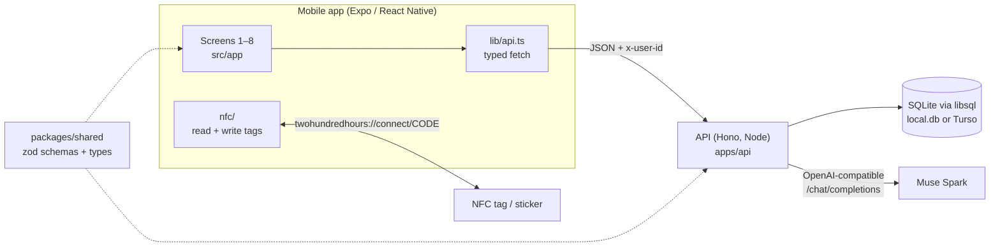

# Architecture

**Why this stack:** one language (TypeScript) end to end so any teammate can work on any lane; a shared zod package is the API contract; SQLite needs zero setup and can move to a hosted Turso DB by changing `DATABASE_URL`; Expo gets one codebase onto iOS, Android, and web.

## Data model

All tables live in [apps/api/src/db/schema.ts](../apps/api/src/db/schema.ts). IDs are readable prefixed strings (`u_sam`, `c_climb`).

| Table | What it holds |
| --- | --- |
| `users` | Profile, interests, availability slots, one Hinge-style prompt |
| `crews` | Weekly activity: day, start time, place, size. `owner_id` null = AI-run (open join); set = owner approves joins |
| `memberships` | Who is in which crew (`active` / `pending`), plus `last_read_at` for unread counts |
| `sessions` | One meeting of a crew. Weekly ones are created lazily; one-off plans locked by a poll have a `title` |
| `attendance` | `going` or `checked_in` per person per session. **Friendship hours come from here** |
| `messages`, `polls`, `votes` | Crew chat, AI plan polls, votes |
| `likes`, `connections` | Discover likes; mutual likes and NFC taps become connections |
| `connect_codes` | Short-lived codes carried by NFC tags |

## Friendship hours

Hours between two people = the summed duration of every session **both** checked in to, plus each mutually completed First 20 ([domain/hours.ts](../apps/api/src/domain/hours.ts)). Milestones follow Hall (2018): 50h casual friend, 90h friend, 200h close friend ([packages/shared/src/hours.ts](../packages/shared/src/hours.ts)). The ring on Home fills as hours / next milestone.

First 20 adds server-timed, mutually confirmed 1:1 hangouts. A next step is verified check-ins (time window plus location or an NFC tap at the venue).

## Matching

Pure functions in [domain/matching.ts](../apps/api/src/domain/matching.ts), unit-tested:
- **Crews:** exclude full crews and crews outside your free slots; a shared interest dominates; then prefer crews that already have a few people but still have room.
- **People (Discover):** most shared interests first; hides people you've liked, connected with, or already spend time with.

## AI (Muse Spark)

Every AI call goes through one function, `generate()` in [ai/client.ts](../apps/api/src/ai/client.ts): it sends the prompt plus a JSON Schema (generated from a zod schema) to an OpenAI-compatible `/chat/completions` endpoint, extracts the JSON reply, and validates it. On any failure it returns `null`, and every feature in [ai/features.ts](../apps/api/src/ai/features.ts) falls back to a template, so the app never blocks on AI.

| Feature | Screen | Function | Cached |
| --- | --- | --- | --- |
| Free text → interest + availability chips | 1 | `extractInterests` | no |
| "Why this crew" one-liner | 2 | `crewReason` | 24h per person+crew |
| Plan ideas posted as a poll | 5 | `planPoll` | no |
| Level-up nudge ("12 hours with Sam… invite Sam to food after") | 6 | `nextStep` | per 5 hours of progress |

**Provider config** (`apps/api/.env`): `MODEL_API_KEY` (`MUSE_API_KEY` is a legacy alias), `MUSE_BASE_URL` (default `https://api.meta.ai/v1`), `MUSE_MODEL` (default `muse-spark-1.3`). Defaults follow [Meta Model API documentation](https://dev.meta.ai/docs/protocols/chat-completions). Compatible providers can be configured explicitly. First 20 conversation ideas use this same client, with a saved AI/template source label.

**Voice onboarding:** `expo-speech-recognition` uses native iOS/Android speech recognition or Web Speech Recognition. The user starts and stops the mic, reviews an editable transcript, then taps **Suggest my tags** to call `/ai/interests`. Only text reaches our backend. Recording stops after at most 60 seconds and is aborted when leaving the screen. Mobile requires a development build with microphone/speech permissions; Expo Go and unsupported browsers keep the typed path. Recognition may contact the platform's speech service. The API validates up to 2,000 characters and returns `source: ai | fallback` with the tags. Muse Spark interprets the transcript; it does not transcribe audio in this flow. Meta currently [notes degraded audio support for Spark 1.3](https://dev.meta.ai/docs/video-understanding).

## First Chapter / NFC and iPhone bump

See [FIRST_CHAPTER.md](FIRST_CHAPTER.md) for the implemented flow, two-phone setup, demo script, and device-validation limits.

`tap_moments` stores the host, guest, single-use invitation code, saved conversation activity/source, server start/expiry times, and both completion receipts. The connection is created only when the host accepts the guest. Friendship hours combine checked-in crew sessions and completed First 20 moments. Cancelled, expired, pending, or singly confirmed moments earn no time.

The iOS local Expo module uses MultipeerConnectivity and Core Motion; it does not use NFC or UWB. NFC cards carry only a short-lived `twohundredhours://connect/CODE` invitation. Code entry uses the same server flow. Opening a link previews the invitation without claiming it; unsigned users retain the code through onboarding.

New endpoints: `GET /connect/current`, `GET /connect/code/:code` (host only), `GET /connect/preview/:code`, `GET /connect/moments/:id`, and `POST /connect/moments/:id` with `{action: "start" | "confirm" | "cancel"}`. `POST /connect/redeem` now returns a `TapMoment` rather than creating a connection immediately.

Local libsql transactions are queued to prevent concurrent async transactions colliding on the shared write connection. Unique invitation claims and all state transitions are transactional.

## API

All bodies are validated against `packages/shared` schemas; errors are always `{ "message": string }`. Everything except the first group needs the `x-user-id` header.

| Method | Path | Screen |
| --- | --- | --- |
| POST | `/users` | 1: create account |
| POST | `/ai/interests` | 1: text → chips |
| GET | `/users`, `/users/:id` | dev helper / profile |
| GET | `/me/crew-suggestion?skip=` | 2 |
| POST | `/crews/:id/join` | 2, 4, 8 |
| GET | `/me/home`, `/me/chats` | 3, Chats tab |
| POST | `/sessions/:id/attendance` `{status}` | 3 check in, 8 going |
| GET | `/discover/people`, `/discover/crews` | 4 |
| POST | `/likes` | 4 |
| GET/POST | `/crews/:id/messages` | 5 |
| POST | `/crews/:id/plan`, `/polls/:id/vote` | 5 |
| GET | `/friends/:userId` | 6 |
| GET | `/crews/demand?activity=` | 7 |
| POST | `/crews` | 7 |
| GET | `/crews/:id` | 8 |
| POST | `/crews/:id/members/:userId` `{action}` | 8 |
| POST | `/connect/code`, `/connect/redeem` | Tap to connect |

## Auth

Hackathon stub: the app stores a user id on the device and sends it as `x-user-id` ([apps/api/src/auth.ts](../apps/api/src/auth.ts)). Replace it before real users (e.g. Clerk, Supabase Auth, or Sign in with Apple), keeping `c.get('userId')` as the interface routes use.
