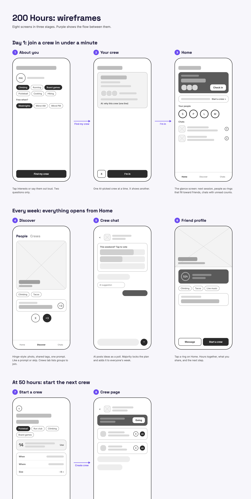

# 200 Hours: product brief

## Problem

People who move to a new city, school, or job rarely turn new acquaintances into real friends. A 2018 study by Jeffrey Hall (University of Kansas) found it takes about **50 hours** together to become casual friends, **90 hours** to become friends, and **more than 200 hours** to become close friends.

Most newcomers never get there. One-off events and meetup apps create first meetings, but nothing repeats, so the hours never add up.

## Solution

AI that turns strangers into friends by making time together repeat, then helping it deepen.

1. **Tell it about you:** new in town, your interests, your free time.
2. **Get a weekly routine:** the AI picks recurring activities (climbing Tuesdays, run club Saturdays) and matches you with other newcomers who commit to the same slots.
3. **Track friendship hours:** time with each person adds up on a meter toward 50, 90, and 200 hours.
4. **Get nudged to level up:** at the right moment it suggests the next step, e.g. "12 hours with Sam at climbing. Invite Sam to grab food after."
5. **Swap profiles in person:** tap phones (NFC) with someone you just met to connect.

The AI does the hard part: consistency and escalation, not one-time matchmaking.

## Screens

| Stage | # | Screen | What it does |
| --- | --- | --- | --- |
| Day 1: join a crew in under a minute | 1 | About you | Tap interests or say them out loud. Two questions only. |
| | 2 | Your crew | One AI-picked crew at a time, with a one-line reason. ✕ shows another. |
| | 3 | Home | Next session, people as rings that fill toward friends, chats with unread counts. |
| Every week: everything opens from Home | 4 | Discover | Hinge-style: photo, shared tags, one prompt. Like or skip. Crews tab lists groups to join. |
| | 5 | Crew chat | AI posts ideas as a poll. A majority locks the plan and adds it to everyone's week. |
| | 6 | Friend profile | Tap a ring: hours together, what you share, the next step. |
| At 50 hours: start the next crew | 7 | Start a crew | Pick an activity, see local demand, set when/where/size. |
| | 8 | Crew page | Next session with "Going", join requests, members. |

## Demo script (about 2 minutes, seeded data)

1. Onboard a new person on screen 1, get a crew suggestion on screen 2, tap **I'm in**, and land on Home.
2. Switch to **Alex** (the seeded account). Home shows Sam at 52h, a casual friend.
3. Tap Sam's ring to show the hours meter and the AI's next step.
4. Open **Tuesday Climbers** chat and vote in the poll. It locks (2 of 3) and lands on everyone's week.
5. **Tap to connect:** write a code to an NFC tag on one phone and scan it with another. The new connection appears as an empty ring on Home.
6. Open **Taco Tour** (Alex's crew) and approve a join request.
